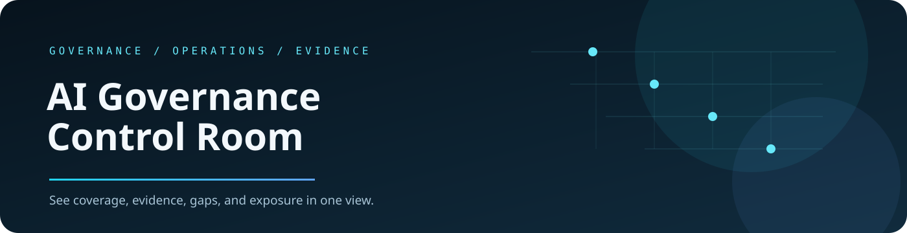
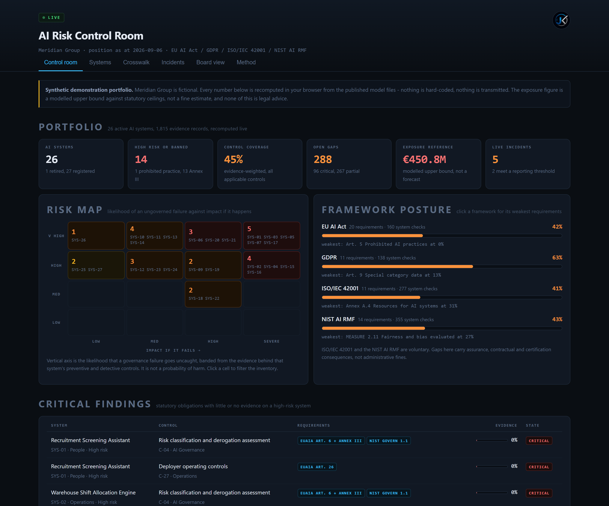
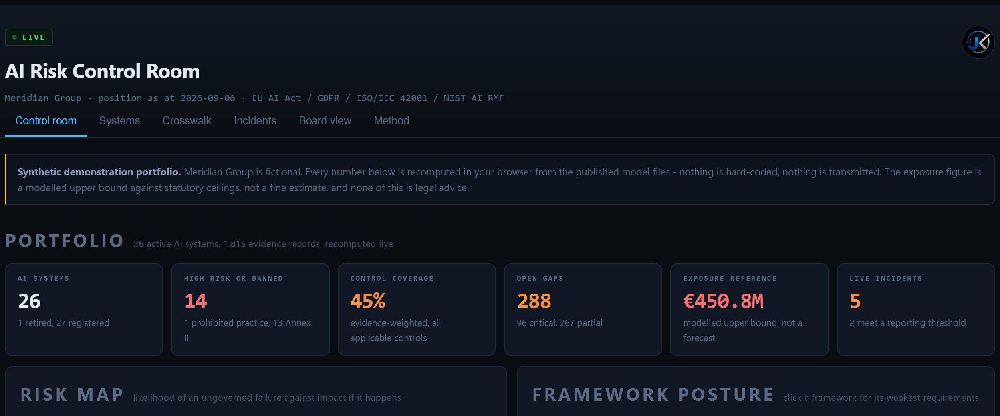
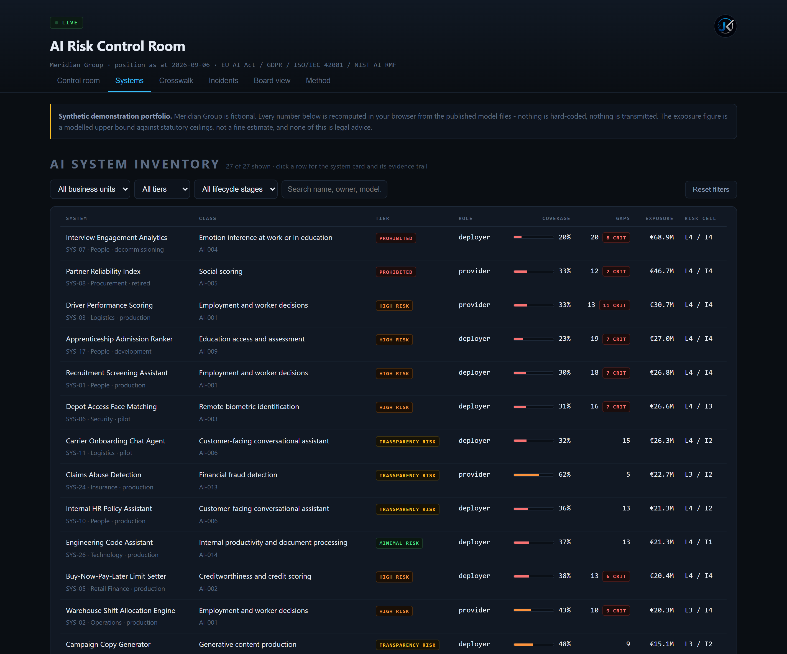
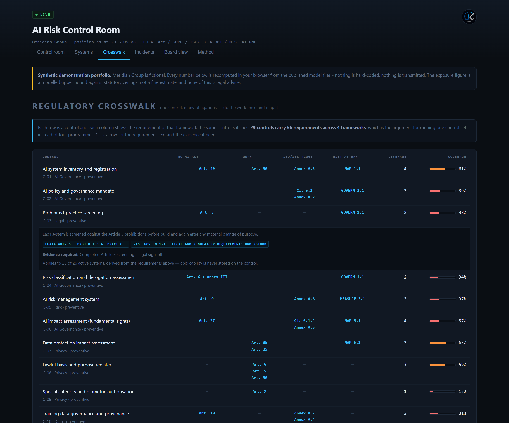
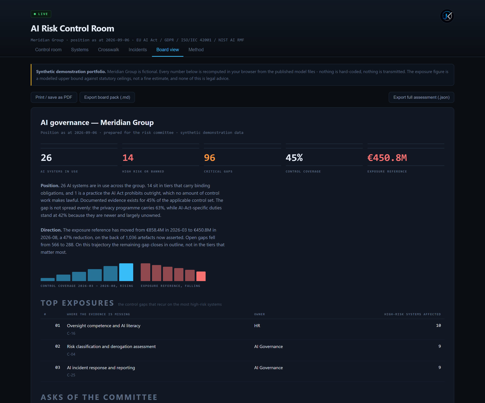

<p align="center">
  
</p>

<p align="center">
  <a href="https://jeevan-0508.github.io/ai-governance-control-room/">Open the demo</a> ·
  <a href="https://jeevan-0508.github.io/ai-governance-control-room/docs/live/">Open the operator console</a> ·
  <a href="#product-tour">Product tour</a> ·
  <a href="#run-locally">Run locally</a>
</p>

# AI Governance Control Room

### A browser-first console for understanding AI governance exposure.

The Control Room brings systems, obligations, evidence, controls, gaps, and board-ready views into one calm operating surface. It helps a governance team see what is covered, what is missing, and where the evidence is still thin—without pretending that one score proves compliance.

`BROWSER-ONLY` · `NO ACCOUNT` · `NO TELEMETRY` · `EU AI ACT / GDPR / ISO 42001 / NIST AI RMF`

## Start with the product

| Try this | What you will see |
| --- | --- |
| **[Demo control room](https://jeevan-0508.github.io/ai-governance-control-room/)** | A populated fictional organisation with systems, risk, evidence, crosswalks, and board views ready to explore. |
| **[Operator console](https://jeevan-0508.github.io/ai-governance-control-room/docs/live/)** | An empty workspace for registering your own AI systems and recording evidence in the browser. |

## Product tour

<p align="center"></p>

<table>
  <tr>
    <td width="50%"><br><strong>See the portfolio</strong><br>Move from a high-level view into the systems that drive exposure.</td>
    <td width="50%"><br><strong>Keep an inventory</strong><br>Give every system an owner, purpose, risk tier, and evidence trail.</td>
  </tr>
  <tr>
    <td width="50%"><br><strong>Trace obligations</strong><br>Compare control coverage across the frameworks that matter to the programme.</td>
    <td width="50%"><br><strong>Tell the decision story</strong><br>Turn operational evidence into a view leaders can challenge and act on.</td>
  </tr>
</table>

## What makes it useful

- **One operating surface** for inventory, framework coverage, evidence, gaps, and exposure.
- **Evidence before confidence** so an empty field stays visible instead of becoming a reassuring score.
- **Two modes**: explore a populated demo or start a clean operator workspace.
- **Private by default**: the static build runs in the browser and stores nothing on a server.

## Run locally

```bash
python3 -m http.server 4173
```

Open `http://localhost:4173/` for the demo or `http://localhost:4173/docs/live/` for the operator console.

<details>
<summary><strong>Implementation notes</strong></summary>

The app is a dependency-light static experience backed by published JSON and local scripts. The four framework views are deliberately framed as crosswalks and evidence surfaces, not legal advice or an automated declaration of compliance. Browser-local changes are not synced to a server.

</details>

## Related work

[POLICY//AUDIT](https://github.com/Jeevan-0508/policy-audit) · [RISK//MESH](https://github.com/Jeevan-0508/Risk-Mesh) · [RISK//REPLAY](https://github.com/Jeevan-0508/risk-replay)

<p align="center"><sub>Built by <a href="https://github.com/Jeevan-0508">Jeevan Siddhabhaktula</a> · MIT licensed</sub></p>
